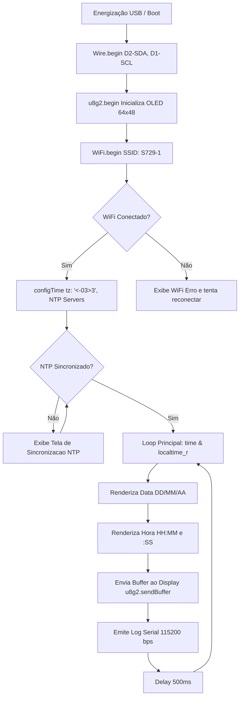

# Functional Specification Document (FSD)

### 1. Document Control
* **Title:** Functional Specification Document - ESP8266 D1 Mini OLED 64x48 NTP Clock
* **Status:** Approved / Functional Baseline
* **Target Version:** 1.0.0
* **Author:** Antigravity AI Assistant
* **Date:** 27/10/2026
* **Hardware Target:** ESP8266EX (WEMOS D1 Mini) + Wemos OLED Shield (SSD1306 64x48 I2C)

---

### 2. Executive Summary & Objectives

* **High-Level Description:**  
  Este projeto consiste no firmware para o microcontrolador ESP8266EX (placa WEMOS D1 Mini) acoplado a um display OLED monocromático de 64x48 pixels. O dispositivo conecta-se a uma rede Wi-Fi local pré-configurada, obtém a hora oficial via servidores de protocolo NTP (Network Time Protocol) com ajuste de fuso horário para São Paulo, Brasil (UTC-3), e exibe continuamente a data e a hora com atualização em tempo real. A renderização gráfica é realizada utilizando a biblioteca gráfica `U8g2`.

* **Problem Statement:**  
  Sistemas embarcados compactos frequentemente necessitam de relógios locais autônomos sem adicionar o custo ou o espaço de módulos RTC (Real Time Clock) baseados em bateria. A solução aproveita a conectividade Wi-Fi nativa do ESP8266 e a sincronização NTP para manter alta precisão temporal em uma área física ultracompacta (display de 64x48 pixels).

* **Out of Scope:**  
  * Portal cativo ou interface web para configuração dinâmica de SSID/senha (Wi-Fi Manager) - as credenciais são estáticas na versão 1.0.0.
  * Suporte a múltiplos fusos horários configuráveis pelo usuário via botões ou interface externa.
  * Ajuste dinâmico de brilho via sensor LDR ou interface de usuário.
  * Suporte a alarmes sonoros ou saídas digitais de acionamento.

---

### 3. User Personas & User Journeys

* **User Persona:**
  * **Operador / Desenvolvedor de Embarcados:** Necessita de um dispositivo compacto que, ao ser energizado via USB, conecte-se automaticamente à infraestrutura de rede e apresente imediatamente informações de data e hora locais sincronizadas.

* **User Journey:**
  1. O usuário energiza a placa D1 Mini conectando o cabo USB (ou conectando à porta COM15).
  2. O display OLED inicializa e exibe a mensagem de status `"WiFi... Conectando"`.
  3. O ESP8266 autentica-se na rede Wi-Fi `S729-1`.
  4. O display exibe brevemente `"WiFi OK"` com o endereço IP atribuído.
  5. Enquanto a requisição NTP inicial é processada, a tela mostra `"Sincroniz. Hora NTP.."`.
  6. Uma vez sincronizado o timestamp, o display assume o modo de operação principal:
     * Linha Superior: Data no padrão `DD/MM/AA` (centralizada).
     * Linha Divisória horizontal.
     * Centro: Horário em fonte ampliada `HH:MM` acompanhado dos segundos `:SS`.
     * Linha Inferior: Indicador regional `SP - Brasil`.
  7. A cada 500ms, o display é atualizado com precisão de segundos e status de telemetria emitido via Serial (115200 bps).

---

### 4. Functional Requirements

| ID | Módulo / Componente | Descrição do Requisito | Prioridade |
| :--- | :--- | :--- | :--- |
| **FR-01** | Inicialização / Hardware | O firmware DEVE inicializar o barramento I2C usando explicitamente os pinos `D2` (SDA / GPIO4) e `D1` (SCL / GPIO5) em conformidade com o shield Wemos OLED 64x48. | P0 |
| **FR-02** | Driver Gráfico | O sistema DEVE utilizar a biblioteca `U8g2` com o driver de hardware `U8G2_SSD1306_64X48_ER_F_HW_I2C` operando com rotação padrão (`U8G2_R0`) e sem pino de reset físico (`U8X8_PIN_NONE`). | P0 |
| **FR-03** | Conectividade Wi-Fi | O dispositivo DEVE conectar-se automaticamente em modo estação (`WIFI_STA`) ao SSID `S729-1` com a senha `25102026`. | P0 |
| **FR-04** | Resiliência Wi-Fi | Caso a conexão Wi-Fi caia ou falhe durante a inicialização, o dispositivo DEVE manter o loop operacional e exibir indicação de status (`Sem Wi-Fi` ou tentativa de reconexão) sem bloquear o microcontrolador. | P1 |
| **FR-05** | Fuso Horário e NTP | O firmware DEVE aplicar a string de configuração POSIX TZ `<-03>3` (horário padrão de Brasília/São Paulo, UTC-3 sem horário de verão) e consultar prioritariamente `a.st1.ntp.br`, `b.st1.ntp.br` e `pool.ntp.org`. | P0 |
| **FR-06** | Formatação de Data | A data DEVE ser formatada e exibida como `DD/MM/AA` centralizada na largura de 64 pixels do display. | P0 |
| **FR-07** | Formatação de Hora | As horas e minutos DEVEM ser exibidos no formato `HH:MM` com fonte de alta visibilidade (`u8g2_font_7x14B_tf`), acompanhados dos segundos `:SS` em tamanho reduzido (`u8g2_font_5x7_tf`). | P0 |
| **FR-08** | Telemetria Serial | O firmware DEVE emitir a cada ciclo de atualização pela porta Serial a 115200 bps o log formatado `[DD/MM/AA HH:MM:SS] Atualizado display.`. | P1 |

---

### 5. Data Flow & Interface Specifications

#### 5.1 Arquitetura de Comunicação e Hardware

#### 5.2 Mapeamento de Pinos e Conexões

| Função | Pino D1 Mini | GPIO ESP8266 | Conexão no Shield OLED |
| :--- | :--- | :--- | :--- |
| **SCL (I2C)** | D1 | GPIO5 | SCL do display SSD1306 |
| **SDA (I2C)** | D2 | GPIO4 | SDA do display SSD1306 |
| **Alimentação** | 3V3 / 5V | 3.3V | VCC |
| **GND** | G | GND | GND |

#### 5.3 Fontes Gráficas Utilizadas (U8g2)
* `u8g2_font_5x7_tf`: Utilizada para títulos, data (`DD/MM/AA`), mensagens de inicialização e segundos (`:SS`).
* `u8g2_font_7x14B_tf`: Utilizada para o horário principal (`HH:MM`), em negrito para contraste.
* `u8g2_font_4x6_tf`: Utilizada para o rodapé regional (`SP - Brasil`) e diagnóstico compacto.

---

### 6. Non-Functional Requirements

* **Performance:**
  * O ciclo de refresh do display e da serial DEVE ocorrer em intervalos de aproximadamente 500 ms, garantindo transição suave dos segundos sem sobrecarregar o barramento I2C nem estourar o Watchdog Timer (WDT) do ESP8266.
  * Consumo de memória RAM estática inferior a 45% do disponível no heap (atualmente utiliza ~37% da RAM).
* **Confiabilidade:**
  * Utilização da função `localtime_r` para garantir thread-safety e evitar corrupção de ponteiros de tempo.
  * Validação explícita de ano (`timeinfo.tm_year > (2020 - 1900)`) antes de exibir a tela principal, prevenindo exibição da época Unix padrão (01/01/1970).
* **Manutenibilidade:**
  * Código modular em arquivo único compatível com `arduino-cli` e Arduino IDE 2.x, sem dependências proprietárias além dos pacotes padrão ESP8266 e U8g2.

---

### 7. Acceptance Criteria

* [x] **AC-01 (Conexão Wi-Fi):**
  * **Given** a placa D1 Mini conectada à alimentação,
  * **When** o ciclo de setup for executado dentro do alcance da rede `S729-1`,
  * **Then** a placa deve obter um endereço IP válido via DHCP e imprimir o IP na Serial.

* [x] **AC-02 (Sincronização de Horário):**
  * **Given** a rede Wi-Fi conectada,
  * **When** os servidores NTP forem consultados,
  * **Then** o horário sincronizado deve corresponder ao horário oficial de São Paulo (UTC-3).

* [x] **AC-03 (Exibição no Display OLED):**
  * **Given** o display Wemos OLED 64x48 acoplado,
  * **When** os buffers forem desenhados pela biblioteca U8g2,
  * **Then** a data `DD/MM/AA` deve estar visível e centralizada no topo, o horário `HH:MM` legível no centro com os segundos `:SS`, e a identificação `SP - Brasil` no rodapé, sem cortes visuais.

* [x] **AC-04 (Operação Contínua):**
  * **Given** o sistema em loop contínuo,
  * **When** decorrer o tempo de operação,
  * **Then** os segundos e minutos devem atualizar em tempo real e os logs seriais emitidos a 115200 bps sem interrupções por reset de WDT.
